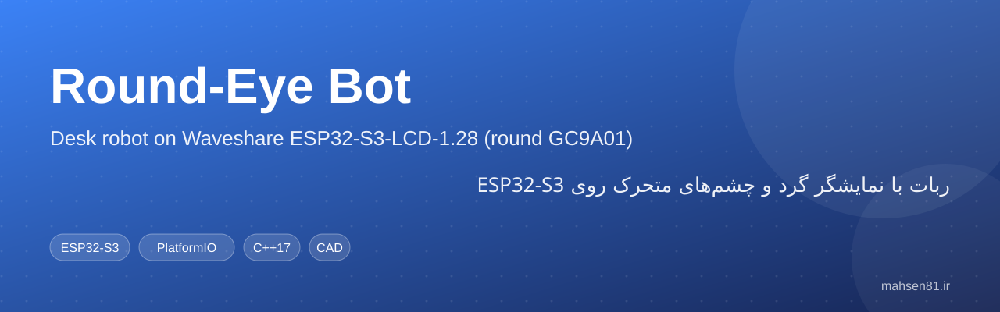

<!-- gen:header -->
<p align="center"></p>

<h1 align="center">Round-Eye Bot</h1>
<p align="center"><b>ربات با نمایشگر گرد و چشم‌های متحرک روی ESP32-S3</b><br><i>Desk robot on Waveshare ESP32-S3-LCD-1.28 (round GC9A01)</i></p>
<p align="center">   </p>

<div dir="rtl">

## ✨ امکانات

- انیمیشن روان روی نمایشگر گرد ۲۴۰×۲۴۰
- فایل‌های CAD بدنه
- تست و ابزارهای کمکی

</div>

## 🚀 Quick start

```bash
pio run -t upload
```

---

<p align="center">ساخته‌شده توسط <a href="https://mahsen81.ir"><b>محسن جباره‌اصل</b></a> — برنامه‌نویسی، طراحی سایت، ربات و هوش مصنوعی<br>
Built by <a href="https://mahsen81.ir">Mohsen Jabbareh-Asl</a> · ⭐ اگر مفید بود، ستاره بدهید · Need a custom version? <a href="https://mahsen81.ir">Get in touch</a></p>
